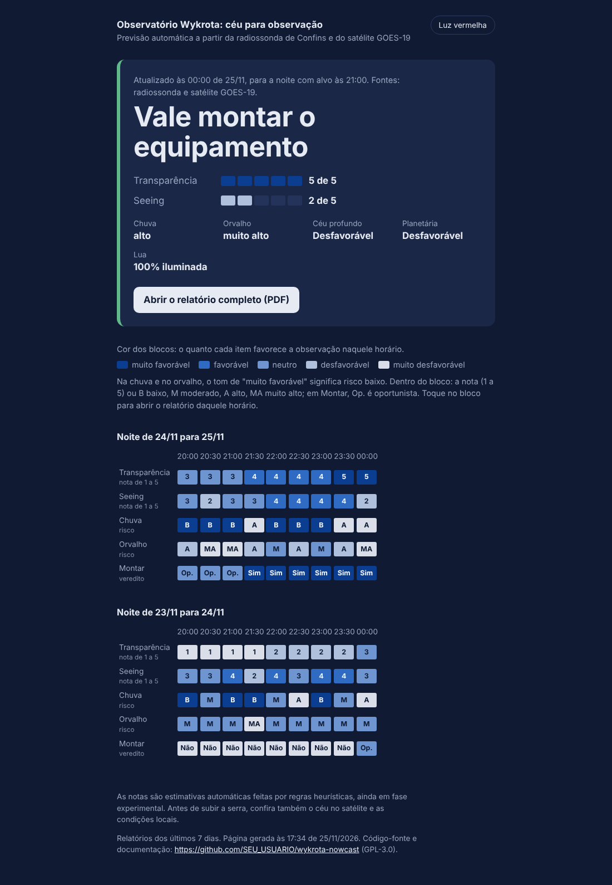
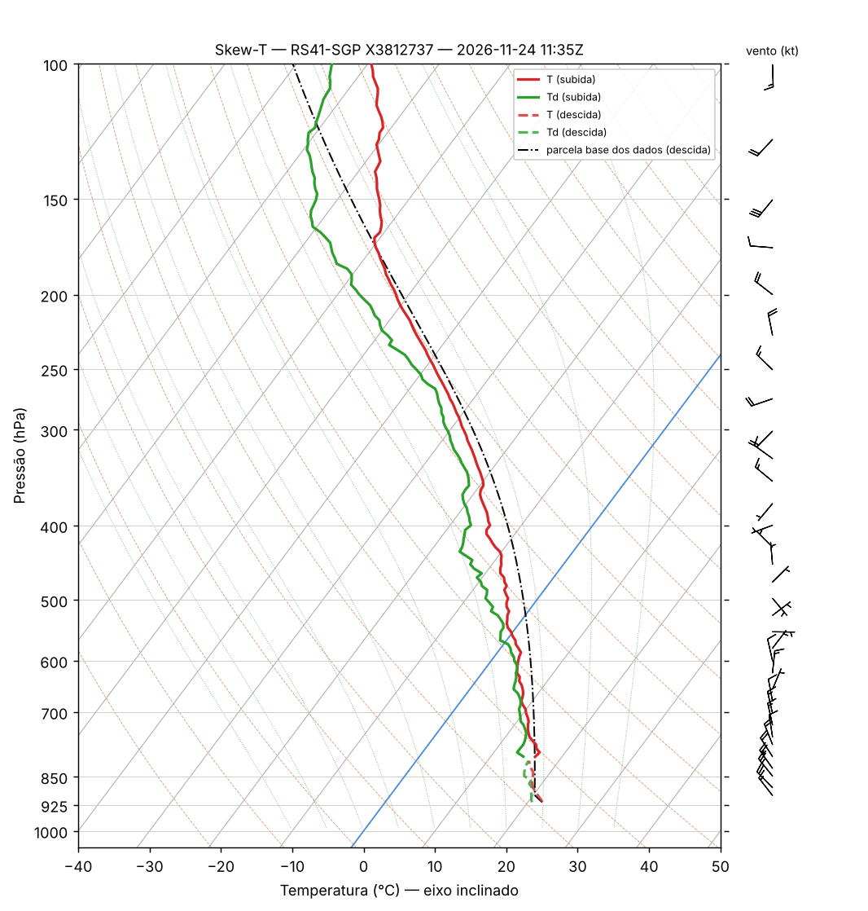
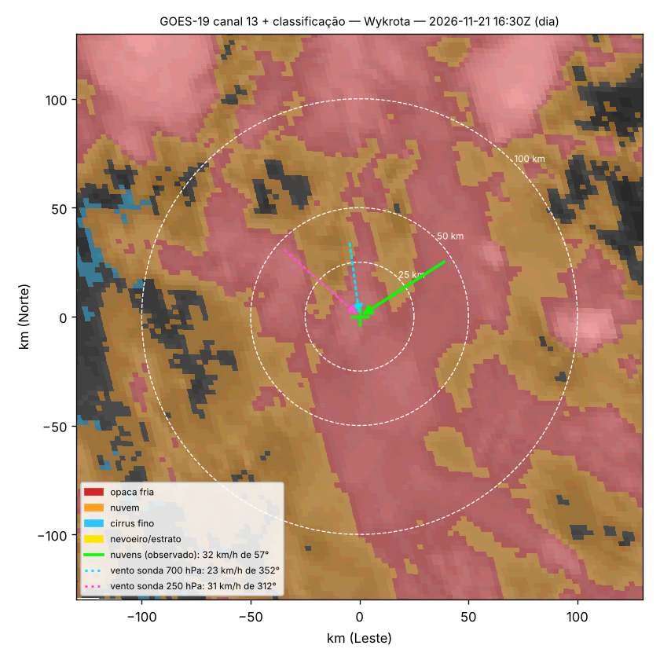

# wykrota-nowcast

Previsão automática das condições do céu para observação astronômica no **Observatório Wykrota** (Serra da Piedade, MG). O sistema combina duas fontes recebidas por rádio, com equipamento amador:

- a **radiossonda** lançada em Confins (SBCF), recebida com SDR pelo [radiosonde_auto_rx](https://github.com/projecthorus/radiosonde_auto_rx);
- as imagens e os produtos do satélite **GOES-19**, recebidos por HRIT e processados pelo [SatDump](https://github.com/SatDump/SatDump).

A cada execução sai um relatório em PDF com as notas de **transparência** e **seeing** (1 a 5), o risco de **chuva** e de **orvalho** e uma recomendação: céu profundo, planetária/lunar ou não montar o equipamento. Os relatórios podem ser publicados automaticamente numa GitHub Page.



## Como funciona

```
 radiossonda (log do auto_rx) ──► astro_sounding.py ──► JSON com perfil, ventos e T/Td no observatório
                                                    │
 GOES-19 HRIT (SatDump):                             ▼
   canais 2, 7, 13, 15 ─────────► goes_nowcast.py ──► nuvens, cirrus, nevoeiro, tendência,
   L2: ACHA ACHT DSI LST TPW ─┘                       deslocamento e chegada das nuvens
                                                    │
                                                    ▼
                               astro_sounding.py --sat-json ──► relatório final (PDF + JSON)
                                                    │
                                                    ▼
                                   publicar.sh ──► GitHub Page (últimos 7 dias)
```

| Arquivo | Função |
|---|---|
| `astro_sounding.py` | Análise da sondagem: Skew-T, CAPE/CIN, camadas de nuvem, cisalhamento e número de Richardson, orvalho, notas e veredito. Combina com o satélite. |
| `goes_nowcast.py` | Nowcasting com o GOES-19: classificação de nuvens, raios de 25, 50 e 100 km, tendência, deslocamento e produtos L2. |
| `lrit_info.py` | Mostra o cabeçalho dos `.lrit` (produto, horário, tabela de calibração). |
| `previsao.sh` | Executa tudo em sequência. Ignora sondagens ainda em voo. |
| `gerar_site.py` / `publicar.sh` | Gera e publica a página com os PDFs. |
| `verificar.py` / `verificar.sh` | Confere as previsões com a nebulosidade observada pelo GOES-19 e com o registro manual. |
| `registro_observacoes.csv` | Registro do que os observadores viram (formato em [docs/registro_observacoes.md](docs/registro_observacoes.md)). |
| `astro_config.toml` | Todos os limiares das regras. |
| `config.local.sh.example` | Modelo da configuração da sua máquina (caminhos, observatório, publicação). |

## Instalação

```bash
git clone https://github.com/SEU_USUARIO/wykrota-nowcast.git
cd wykrota-nowcast
python3 -m venv ~/.venvs/astro
~/.venvs/astro/bin/pip install numpy pandas matplotlib reportlab pillow
cp config.local.sh.example config.local.sh   # ajuste caminhos e observatório
```

Requer Python 3.11 ou mais recente. O `product.cbor` do SatDump e os cabeçalhos LRIT são lidos por código próprio, sem dependências extras.

**Requisitos de recepção:**

- radiosonde_auto_rx gravando os `*_sonde.log`;
- SatDump (testado na 1.2.2) recebendo o GOES-19 HRIT, com "salvar LRIT" ativado para obter a calibração dos produtos L2.

## Uso

```bash
./previsao.sh                       # alvo: próxima 00Z
./previsao.sh 2026-11-25T00:00Z     # alvo explícito
```

Exemplo de cron, a cada 30 minutos entre 20h e 0h:

```cron
*/30 20-23 * * * /caminho/wykrota-nowcast/previsao.sh >> $HOME/astro_previsoes/cron.log 2>&1
0 0 * * *        /caminho/wykrota-nowcast/previsao.sh >> $HOME/astro_previsoes/cron.log 2>&1
```

Também dá para rodar cada parte separadamente:

```bash
python3 astro_sounding.py LOG --site Wykrota --lat -19.824167 --lon -43.690278 --obs-elev 1500 --json s.json
python3 goes_nowcast.py --root ".../IMAGES/GOES-19/Full Disk" --l2-root ".../L2/GOES-19/Full Disk" \
    --lrit-dir ".../LRIT" --site Wykrota --lat -19.824167 --lon -43.690278 --sounding-json s.json --json g.json
python3 astro_sounding.py LOG --site Wykrota --lat -19.824167 --lon -43.690278 --obs-elev 1500 --sat-json g.json
```

- O vento sai em **km/h**. Para mudar, use `[unidades] vento` no `astro_config.toml` ou `--wind-unit m/s`.
- Use só a pasta `Full Disk`: os setores Mesoscale do HRIT cobrem a América do Norte.

## Publicação na GitHub Page

Os relatórios ficam na branch `gh-pages`. Ela é **recriada a cada publicação com um único commit**, contendo só os PDFs dos últimos `DIAS_PAGINA` dias (padrão: 7), para que o repositório não cresça com PDFs antigos.

1. Gere uma chave SSH só para publicar:

   ```bash
   ssh-keygen -t ed25519 -N "" -f ~/.ssh/wykrota_deploy
   ```

2. No GitHub, abra **Settings → Deploy keys → Add deploy key**, cole o conteúdo de `~/.ssh/wykrota_deploy.pub` e marque **Allow write access**.
3. No `~/.ssh/config`, adicione:

   ```
   Host github-wykrota
       HostName github.com
       User git
       IdentityFile ~/.ssh/wykrota_deploy
       IdentitiesOnly yes
   ```

4. No `config.local.sh`, defina `PUBLICAR=1` e `GIT_REMOTE="git@github-wykrota:SEU_USUARIO/wykrota-nowcast.git"`.
5. Rode `./publicar.sh` uma vez. Depois, em **Settings → Pages**, escolha **Deploy from a branch → gh-pages → / (root)**.

A página fica em `https://SEU_USUARIO.github.io/wykrota-nowcast/`. O link fixo para o relatório mais recente é `…/relatorios/ultimo.pdf`. A página tem um modo de **luz vermelha**, para consultar no observatório sem perder a adaptação ao escuro.

## Verificação das previsões

As notas só ficam confiáveis depois de comparadas com o que aconteceu. O `verificar.sh` faz isso todo dia:

1. **Automático, pelo satélite.** Para cada relatório, mede o céu claro e os cirrus num raio de 25 km do observatório, nas imagens do GOES-19 do horário-alvo até 3 h depois. Converte isso numa "transparência observada" de 1 a 5 e compara com a prevista. O resultado de cada imagem fica em cache, então a verificação continua valendo depois que as imagens forem apagadas.
2. **Registro dos observadores.** Se o `registro_observacoes.csv` tiver noites anotadas, compara também transparência e seeing com o que foi visto no local. O formato e as escalas estão em [docs/registro_observacoes.md](docs/registro_observacoes.md).

Cron sugerido, de manhã:

```cron
10 7 * * * /caminho/wykrota-nowcast/verificar.sh >> $HOME/astro_previsoes/cron.log 2>&1
```

Saídas em `$OUT/verificacao/`:

- `verificacao.csv`: uma linha por previsão;
- `verificacao_resumo.md`: viés (positivo = otimista demais), erro médio, acertos exatos e com ±1 ponto, por antecedência, mais a matriz de confusão.

A linha mais útil do resumo é a da nota final **com satélite pesando menos de 50%**. Quando o satélite pesa muito, a previsão já é praticamente uma observação.

Com algumas dezenas de noites verificadas, esses números indicam quais limiares do `astro_config.toml` ajustar.

## Como as notas são calculadas

**Sondagem**

- **Transparência:** desconta pontos por camadas de nuvem prováveis ou possíveis (UR em relação à água acima de −20 °C, em relação ao gelo abaixo), por água precipitável alta e por umidade no primeiro quilômetro.
- **Seeing:** desconta pelo vento máximo entre 400 e 150 hPa, pelo cisalhamento em camadas de 500 m, pelas camadas com número de Richardson < 0,25, por CAPE e índice K e pelo vento na altitude do observatório.
- **Observatório:** as condições são lidas no perfil na altitude dele (`--obs-elev`). O relatório avisa se ele está dentro de uma camada úmida.

**Satélite**

- **Classificação dos pixels:**
  - opaca fria: canal 13 abaixo de 253 K;
  - nuvem: canal 13 bem abaixo da referência de céu claro;
  - cirrus fino: excesso de BT13 − BT15 sobre o céu claro local;
  - nevoeiro (só à noite): BT7 − BT13 ≤ −2 K.
- **Movimento:** correlação de fase entre quadros consecutivos, conferida com o vento da sondagem. O script amostra a região contra o vento para estimar a chegada ou abertura das nuvens.
- **Produtos L2:**
  - ACHA e ACHT: altura e temperatura dos topos;
  - DSI (CAPE) e TPW: substituem os valores da sonda quando o satélite está perto do horário-alvo;
  - LST: alerta de orvalho.
- **Nota final de transparência:** média ponderada entre satélite e sondagem. O peso do satélite cai de 100% (imagem no horário-alvo) a 0% (6 h de diferença).

| Skew-T gerado | Satélite com classificação (exemplo) |
|---|---|
|  |  |

## Limitações

- As notas vêm de **regras heurísticas** e são experimentais. Os limiares em `astro_config.toml` devem ser ajustados comparando com as noites reais.
- A sonda descreve o horário do voo. A das 12Z não capta a convecção da tarde; a das 00Z é a mais representativa para a noite.
- As PNGs do HRIT têm 8 bits (~1 K por nível no infravermelho). Cirrus muito tênues podem passar despercebidos, e nuvens presas à serra ficam no limite da resolução (~2,3 km em MG).
- Em céu totalmente encoberto e uniforme, a estimativa de deslocamento das nuvens fica pouco confiável.
- DSI, TPW e LST só existem em céu claro; ACHA e ACHT, só onde há nuvem.

## Créditos e dados

- Radiossonda: lançamentos operacionais em Confins, recebidos com [radiosonde_auto_rx](https://github.com/projecthorus/radiosonde_auto_rx).
- GOES-19: dados abertos da NOAA, recebidos por HRIT com o [SatDump](https://github.com/SatDump/SatDump).

## Licença

[GPL-3.0-or-later](LICENSE).
